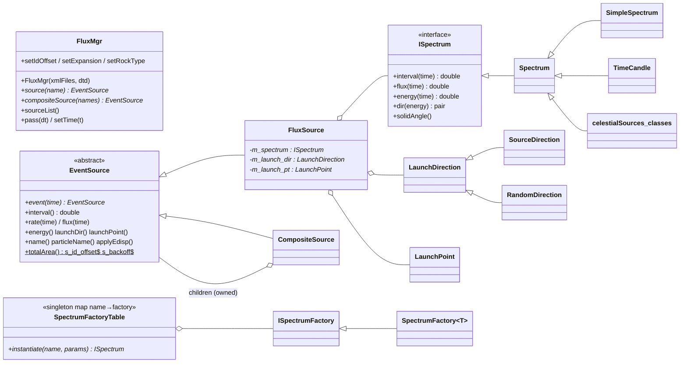

# flux Architecture

**flux** is the source-definition and particle-generation framework that
sits under the photon simulator `gtobssim` (`observationSim`). It does
three things:

1. Parses **source library XML files** (`<source_library>` / `<source>` /
   `<spectrum>`) into named source definitions.
2. Builds an **`EventSource` tree** from a definition. The leaves are
   `FluxSource` objects, each wrapping one `ISpectrum` plus a launch-direction
   and launch-point strategy. Interior nodes are `CompositeSource` objects
   that merge their children into one time-ordered stream.
3. Keeps a **global registry** (`SpectrumFactoryTable`) of `ISpectrum`
   classes by name, so XML can say `<SpectrumClass name="MapSource" .../>`
   and get a class defined in another package (`celestialSources`).

flux has no `gt*` tool of its own. It was inherited from the GLAST
`FluxSvc`/Gleam simulation, so much of the vocabulary (launch points in
millimetres, cosmic-ray muons, "GLAST" frame, Van de Graaff gammas) is for
the full detector simulation, not for `gtobssim`.

**Read this first if you touch the XML parsing.** The Xerces-based parser
was replaced by RapidXML in `1d5fc58` (PR #4, merged July 2026). The rewrite
changed several behaviours that `gtobssim` depends on; see
[Invariants and gotchas](#invariants-and-gotchas) and the comparison table
in [source-xml.md](source-xml.md#behaviour-changes-in-the-rapidxml-rewrite).

The Doxygen mainpage (`src/mainpage.h`, 2003) lists sources that no longer
exist in `xml/source_library.xml` (e.g. `albedo_gamma`, `crab-galactic`).
`doc/FluxSvcDoc2.htm` and `doc/multipower.htm` describe the old Gleam
`FluxSvc`. Use the code and `xml/source.dtd` as the source of truth.

## Purpose and scope

**Does:**
- Read one or more source-library XML files and index every `<source>` by
  its `name` attribute (`FluxMgr`).
- Build a source from a definition: built-in particle spectra (`<particle>`
  with `<energy>`/`<power_law>`), or any registered `ISpectrum` class
  (`<SpectrumClass name=... params=...>`), plus composite sources
  (`<nestedSource sourceRef=...>`).
- Generate events: arrival interval (from the spectrum, or Poisson from
  flux × solid angle × area), energy, direction in the LAT frame, and a
  launch point on a disk or box (mm).
- Convert sky, zenith or spacecraft-frame directions to LAT instrument
  coordinates using `astro::GPS` (orbit, attitude, rocking or pointing
  history).
- Provide a handful of built-in spectra: `SimpleSpectrum` (power law,
  broken power law, monoenergetic), `TimeCandle` (clock ticks),
  `FileSource` (replay particles from an ASCII file), `SurfaceMuons`,
  `VdgGamma`, `Earth` (albedo).

**Does not:**
- Model astrophysical sources beyond simple power laws. Maps, transients,
  pulsars, populations and EBL attenuation are in `celestialSources`.
- Apply instrument response (PSF, energy dispersion, effective area),
  livetime or SAA cuts. `observationSim` does that with `irfs`.
- Write FITS. `observationSim`/`fitsGen` write FT1/FT2.
- Validate XML against `xml/source.dtd`. Since the RapidXML rewrite the
  DTD is installed but never read.

## Position in the system

| Direction | Package | Why |
|-----------|---------|-----|
| Depends on | `astro` | `GPS` singleton (time, orbit, attitude, `transformToGlast`, `LATdirection`, `toSky`, `endTime`), `SkyDir`, `PointingTransform`, `SolarSystem`/`JulianDate` (Sun/Moon/planet frames in `SourceDirection`). |
| Depends on | `xmlBase` | Header-only use of the vendored RapidXML (`xmlBase/rapidxml.hpp`, `safe_xml_parser.hpp`, `rapidxml_error_framework.hpp`, `xml_result.hpp`). `FluxMgr.h` includes these, so every consumer of `FluxMgr.h` sees them too. No `xmlBase` library symbols are used. |
| Depends on | `facilities` | `commonUtilities::getXmlPath("flux")` (default library and DTD path), `Util::expandEnvVar` (file names), `Util::keyValueTokenize` (`FileSource` params). |
| Depends on | CLHEP | `RandFlat` etc. for every random draw; `Hep3Vector`/`HepRotation` in the public API. |
| Linked, unused | cfitsio | `CMakeLists.txt` links `cfitsio::cfitsio` PUBLIC, but nothing in flux includes `fitsio.h`. Leftover link. |
| Used by | `observationSim` | `FluxMgr` (construct from XML list, `source()`, `sourceList()`, `pass()`, `setIdOffset()`, `setExpansion()`), `EventSource`/`CompositeSource` (event loop), `Spectrum::setStartTime`, `SpectrumFactoryTable` (`listSpectra`). |
| Used by | `celestialSources` | Every source class derives from `Spectrum` and registers with `SpectrumFactory<T>`. Tests also use `FluxMgr`, `CompositeSource`, `EventSource::totalArea()`. |

No other package includes flux headers (`Likelihood/src/old_tests` mentions
it but is not built).

## Key abstractions



| Type | Header | Role |
|------|--------|------|
| `FluxMgr` | `flux/FluxMgr.h` | Entry point. Parses XML, keeps `name → (xml node, library title)`, builds sources on demand. Thin wrappers over `astro::GPS` for time, orbit and rocking. Owns the parsed documents, so it must outlive every source it creates (the sources hold `XmlNode*` only during construction, but keep this in mind). |
| `EventSource` | `flux/EventSource.h` | Abstract base of the source tree. Holds the current event's `time`/`interval`, a flux, a name and a code. Static state shared by all sources: **`totalArea`** (m², default 6), `s_backoff` (2000 mm), `s_id_offset`, `s_cone`, alignment matrix. |
| `FluxSource` | `flux/FluxSource.h` | Leaf source built from one `<source>` element. Combines an `ISpectrum` (energy, interval, optionally direction) with a `LaunchDirection` and `LaunchPoint` strategy. Private nested strategies: `RandomDirection` (`<solid_angle>`), `RandomPoint`, `FixedPoint` (`<launch_point>`), `Patch` (`<patch>`). |
| `CompositeSource` | `flux/CompositeSource.h` | Merges children into one stream with a `multimap<nextTime, (member, pendingEvent)>`. Each call to `event(t)` returns the child with the earliest pending event. Disabled children are dropped. **Owns and deletes its children.** `numSource()` produces the MC source ID. |
| `ISpectrum` / `Spectrum` | `flux/ISpectrum.h`, `flux/Spectrum.h` | The plug-in interface. `Spectrum` gives defaults: `flux()=0`, `solidAngle()=1`, `interval()=-1` ("let FluxSource do Poisson"), `energy()` = `operator()(uniform)`, `dir()=(0,0)`. Static `Spectrum::startTime()` is set by `gtobssim` and used by transient sources. |
| `SpectrumFactory<T>` / `ISpectrumFactory` / `SpectrumFactoryTable` | `flux/SpectrumFactory.h`, … | Registration. Constructing a `SpectrumFactory<T>` inserts it into the singleton table under a name derived from `typeid(T).name()`. `instantiate(name, params)` calls `new T(params)`. See [Extension points](#extension-points). |
| `LaunchDirection` | `flux/LaunchDirection.h` | Direction strategy (header-only). Fixed `(theta, phi, frame)` or fixed `SkyDir` with optional radius (uniform disk). `execute(E, t)` recomputes `m_lat_dir` in the LAT frame via `GPS`. |
| `SourceDirection` | `src/SourceDirection.h` (private) | `<use_spectrum frame=...>`: asks the spectrum for `dir(energy)` and interprets it in `zenith`, `nadir`, `equatorial`, `galactic`/`galaxy`, `Sun`, `Moon`, `Jupiter`, `Saturn` frames. Its `solidAngle()` delegates to the spectrum. |
| `LaunchPoint` | `flux/LaunchPoint.h` | Launch-point strategy (mm, instrument frame). |
| `SimpleSpectrum` | `flux/SimpleSpectrum.h` | `<particle>` spectra: `<energy e>`, `<power_law emin emax gamma [ebreak gamma2]>`. `<exponential>` is FATAL ("not implemented"). |
| `Flux` / `IFlux` | `flux/Flux.h`, `flux/IFlux.h` | Old Gleam-facing façade over `FluxMgr`. Compiled into the library; **no users** in ScienceTools. |
| `rootplot` | `flux/rootplot.h`, `src/rootplot/` | Old histogramming test driver. Despite the name it does **not** need ROOT (writes text). Compiled into the library; no users. |
| `MapSpectrum`, `AGNSpectrum` | `flux/MapSpectrum.h`, `flux/AGNSpectrum.h` | Header-only leftovers. Not included anywhere. |

Built-in registered spectra (registered when `FluxMgr::init` runs, see
below): `TimeCandle`, `FileSource`, `SurfaceMuons`, `VdgGamma`, `Earth`,
plus `SimpleSpectrum` (registered by a static object in a translation unit
that is always linked).

## Data flow and control flow

### XML → source tree

```
FluxMgr(fileList)                      // empty list → xml/fermi/flux/source_library.xml
  init():
    for each file: expandEnvVar → read whole file → RapidXML parse
      for each top-level <source_library>: for each <source name=...>:
          m_sources[name] = (node, library title or file name)
    DECLARE_SPECTRUM(TimeCandle, FileSource, SurfaceMuons, VdgGamma, Earth)

FluxMgr::source(name)
  getSourceFromXML(node)
    first child is <nestedSource sourceRef=X> → getSourceFromXML(X)   // see gotcha: only the first one
    otherwise                                 → new FluxSource(node)

FluxSource(node)
  name, flux (source attr), ident
  <spectrum escale=MeV|GeV apply_edisp=...>
     first child <particle>       → new SimpleSpectrum(...)
     first child <SpectrumClass name=N params=P> → SpectrumFactoryTable::instantiate(N, P)
     first child <N .../>         → SpectrumFactoryTable::instantiate(N, "")
  direction child: solid_angle | direction | use_spectrum | galactic_dir | celestial_dir | custom_dir
     (none → RandomDirection(-1,1), i.e. isotropic in the instrument frame)
  next element after it: launch_point | patch | custom_pt   (none → RandomPoint on a disk of area totalArea)
```

The full element and attribute reference is in [source-xml.md](source-xml.md).

### Event generation (how `gtobssim` drives it)

`observationSim::Simulator` builds a top-level `CompositeSource`, adds one
`FluxMgr::source(name)` per requested source (plus `obsSim_timetick30s` when
there is no pointing history), and loops:

```
ev = top->event(absTime)            // CompositeSource: pop earliest pending child
   child->event(t)                  // FluxSource::event
      interval = spectrum->interval(t)
      if interval <= 0:  interval = -ln(1-u) / rate(t)      // rate = flux(t)·solidAngle·totalArea
      if t+interval < GPS::endTime(): computeLaunch(t+interval)   // energy, direction, launch point
      else disable()                // source is dropped from the composite
interval = top->interval()
absTime += interval; FluxMgr::pass(interval)   // advances astro::GPS
EventContainer::addEvent(ev)        // reads energy(), launchDir(), name(), particleName(), applyEdisp(), code()
```

Key points:
- **Two ways to schedule events.** A spectrum that knows its own arrival
  times (all `celestialSources` classes, `TimeCandle`) returns a positive
  `interval()`. Otherwise `FluxSource` draws an exponential interval from
  `flux(t) × solidAngle × EventSource::totalArea()`.
- **Directions are in the LAT frame.** `launchDir()` is the photon's
  direction of travel in instrument coordinates (it points *away* from the
  source). `observationSim` rotates `-launchDir` back to the sky with its
  own spacecraft model.
- **Time lives in `astro::GPS`.** `FluxMgr::pass(dt)`, `setTime(t)` and the
  rocking/pointing-history settings all go to the `GPS` singleton, which
  every direction strategy reads. Two `FluxMgr`s in one process share it.
- **Source IDs.** `CompositeSource::numSource()` returns the spectrum's
  `identifier()` if positive (e.g. `ident` attribute, or per-member IDs
  from `SourcePopulation`), otherwise `s_id_offset + 1000·childIndex`.
  `gtobssim` writes this to `MC_SRC_ID`.

## Public interfaces

### C++ API

Headers are installed to `include/flux`. Consumers use:

- `observationSim`: `FluxMgr.h`, `EventSource.h`, `CompositeSource.h`,
  `SpectrumFactoryTable.h`, `ISpectrumFactory.h`, `SpectrumFactory.h`,
  `Spectrum.h` (for `Spectrum::setStartTime`/`startTime`).
- `celestialSources`: `Spectrum.h`, `SpectrumFactory.h`, `EventSource.h`
  (for `EventSource::totalArea()`), `SpectrumFactoryTable.h`, and in
  tests `FluxMgr.h`, `CompositeSource.h`.

Minimal use:

```cpp
#include "flux/FluxMgr.h"
#include "flux/CompositeSource.h"

std::vector<std::string> files{"$(MYPKGXMLPATH)/my_sources.xml"};  // env vars expanded
FluxMgr mgr(files);
EventSource::totalArea(6.);                   // m^2; static, affects every source
CompositeSource all;                          // owns what you add
all.addSource(mgr.source("my_point_source")); // nullptr if the name is unknown: check it
double t = 0;
for (int i = 0; i < 100; ++i) {
   EventSource* ev = all.event(t);
   if (!ev->enabled()) break;                 // every source exhausted
   t += all.interval();
   mgr.pass(all.interval());                  // keep astro::GPS in step
   use(ev->energy(), ev->launchDir(), ev->name());
}
```

`FluxMgr::test(out, name, n)` does the same loop and prints each particle;
`test_flux` is a wrapper around it.

### Applications

None. `test_flux` is installed to `bin/` but is a test driver
(`test_flux [source|list|help] [count]`).

### Python

None.

### Environment variables

| Variable | Read by | Effect |
|----------|---------|--------|
| `ZENITH_FRAME_FIX` | `SourceDirection::execute` | If set (any value), `use_spectrum frame="zenith"` uses the right-handed nadir-based frame (same as `frame="nadir"`) instead of the original `GPS::ZENITH` transform. `astro` reads the same variable. |
| `$(VAR)` in file names | `FluxMgr::init`, `FileSource` | Expanded with `facilities::Util::expandEnvVar`. |

`FluxMgr` finds its default library and DTD with
`commonUtilities::getXmlPath("flux")`, i.e. `$FERMI_INST_DIR/xml/fermi/flux`
(see "Runtime environment" in ScienceTools' `docs/architecture/README.md`).

### File formats

- **Input:** source-library XML (see [source-xml.md](source-xml.md)).
  `FileSource` reads an ASCII particle list (`sources/test_FileSource.dat`
  is an example; `sources/` is not installed).
- **Installed XML** (`xml/` → `${FERMI_INSTALL_XMLDIR}/flux`):
  `source_library.xml` (default library; test and Gleam-era particle
  sources, `default`, `clock`, `Earth`, `Sun`, `Moon`, diffuse
  extragalactic), `test_sources.xml`, `3EG.xml` (3EG catalog as
  `<particle>` sources), `source.dtd` (not read), `FluxSvcParams.xml`
  (logN-logS tables; nothing in ScienceTools reads it).
- **Output:** none (in-memory events only).

## Build and test

- **CMake target:** `flux` is a **STATIC** library (all of `src/*.cxx`,
  including `Flux.cxx` and `src/rootplot/`). Executable: `test_flux`.
- **Install:** headers → `include/flux`; `xml/` →
  `${FERMI_INSTALL_XMLDIR}/flux`; `libflux.a` → `lib`; `test_flux` → `bin`.
  `sources/` is not installed.
- **`test_flux`** (`src/test/testMgr.cxx`):
  - Not registered with CTest; there are no `add_test` calls.
  - Calls `setupEnvironment()`, then loads the **installed**
    `xml/fermi/flux/source_library.xml`. Needs `FERMI_INST_DIR` (conda
    activation sets it) and a completed install.
  - With no arguments it runs `FluxMgr::test` on every source in the
    library (10 events each) and writes `testMgrOutput.out` to the
    **current directory**. There are no assertions: it only fails if
    something throws.
  - Because of the zero-flux gotcha below, `<particle>` sources print an
    infinite interval and stop after one call (from reading the code; not
    checked at runtime).
- **ST-unit-test:** the default run of ScienceTools'
  `recipe/tests/ST-unit-test` (`unitTestsWithoutRoot`) runs `test_flux`
  with no arguments, then `check_test_flux_output`, which only checks that
  `testMgrOutput.out` **exists**. It computes an `outref` path
  (`share/fermitools/data/flux/outref`) but never compares against it, and
  no flux reference data exists anywhere (not in
  `fermitools-test-scripts-data`, `fermitools-data` `outrefFiles/` or this
  repo). See "Testing" in ScienceTools' `docs/architecture/README.md`.
- **Unused build files:** `SConscript`, `fluxLib.py` (SCons),
  `azure-pipelines.yml`, `src/rootplot/test/roottest.cxx` (not built).

## Invariants and gotchas

**Regressions from the RapidXML rewrite (`1d5fc58`)**

All of these are from reading the code against the pre-rewrite version
(`a069d66`); none was checked at runtime. They affect `gtobssim` because
ScienceTools pins flux at `1d5fc58`. Details and old-vs-new behaviour are in
[source-xml.md](source-xml.md#behaviour-changes-in-the-rapidxml-rewrite).

- **`<particle>` sources emit nothing.** `FluxSource::flux()` now returns
  `m_spectrum->flux(t)` unconditionally. `SimpleSpectrum` does not override
  `Spectrum::flux()`, which returns 0, so the source-level `flux="..."`
  attribute is never used. The rate is 0, the Poisson interval is infinite,
  and the source disables itself on its first call. The old code fell back
  to `EventSource::flux()` when the spectrum flux was 0. This hits every
  `<particle>` point source in `observationSim/xml` (`test_sources.xml`,
  `3EG_catalog.xml`, …) and `obsSim_source_library.xml`'s `default`.
- **Only the first `<nestedSource>` is used.** `FluxMgr::getSourceFromXML`
  follows the first `sourceRef` and returns that single source. The old
  code built a `CompositeSource` of *all* `nestedSource` children. Composite
  definitions such as `Strong_anticenter_sources` (3 members) or the 3EG
  catalogue (271 members) now give one source.
- **`escale="GeV"` energies are not converted.** `computeLaunch` used to
  multiply the spectrum's energy by 1000 for GeV sources. That line is
  gone, so GeV-scale sources now report energies in GeV to code that
  expects MeV.
- **`FluxSource::name()` ignores the spectrum's name.** It used to return
  `spectrum()->name()` when non-empty. `SourcePopulation` (in
  `celestialSources`) sets a per-member name, so `gtobssim`'s per-source
  summary and `MC_SRC_ID` naming collapse to the XML source name.
- **DTD defaults are gone.** RapidXML does not apply `source.dtd`, so a
  missing attribute is now `""`/`0` instead of the DTD default. Examples:
  `<source flux>` 1.0 → 0, `ident` −1 → 0, `<solid_angle mincos>` −0.4 → 0,
  `maxcos` 1.0 → 0, `<direction frame>` `glast` → `""` (still treated as
  the spacecraft frame), `<spectrum particle_name>` `gamma` → not set.
  Write every attribute explicitly.
- **`setFilterCone` and misalignment do nothing.** `FluxSource::occulted()`
  no longer applies the `s_cone` test, and `computeLaunch` no longer applies
  `EventSource::s_alignMatrix` (`FluxMgr::setAlignmentRotation(…, true)`).
  `gtobssim` uses neither.
- **`<spectrum particle_name>` is ignored.** The particle name for a
  `SpectrumClass` source is now read only from a `<particle name>` child,
  which a `SpectrumClass` source does not have.
- **`use_spectrum` with no `frame`:** the default `"zenith"` is filled in
  *after* `m_occultable` is computed, so such a source is marked occultable
  (it was not before). Only matters to callers of `occulted()`; `gtobssim`
  does not call it.

**XML loading**
- **Unreadable or malformed files are skipped with a warning to stderr.**
  `FluxMgr`'s constructor no longer throws on a parse error, so
  `observationSim::Simulator`'s `catch(...)` around it never fires; the
  failure shows up later as "FluxMgr failed to find a source named …".
- Sources are indexed only under top-level `<source_library>` elements. If
  no source has been found yet, a file's root element of any name is
  searched instead. Nested `<source_library>` elements (allowed by the DTD)
  are not searched.
- Duplicate source names: the **last file wins** (`m_sources[name] = …`).
- An unknown spectrum class, angle tag or launch tag calls `FATAL_MACRO`,
  which throws `std::runtime_error` after printing the list of known
  spectrum classes.
- A missing or invalid `escale` prints "bad energy scale declaration" and
  `return`s from the constructor **with `m_launch_dir`/`m_launch_pt`
  uninitialised**. Using or deleting that source is undefined behaviour.

**Global state**
- `EventSource::totalArea()` (default 6 m²), `s_backoff`, `s_id_offset`,
  `s_cone`, the alignment matrix, `Spectrum::startTime()`, the
  `SpectrumFactoryTable` singleton and `astro::GPS` are all process-wide.
  Most `celestialSources` transients read `totalArea()` **in their
  constructors** to pre-draw event times, so set the area before creating
  sources.
- `FluxMgr::setArea` and `EventSource::totalArea(x)` are the same thing.
  `gtobssim` sets it by calling the static through a possibly-null
  `source("default")` pointer.

**Event loop**
- A `FluxSource` disables itself when `t + interval ≥ GPS::endTime()`.
  A `CompositeSource` returns itself, disabled, when all children are
  exhausted. Always test `enabled()` after `event()`.
- `CompositeSource::event` throws `"invalid time"` if a child's next time is
  earlier than the requested time. Do not move time backwards.
- `FluxSource::flux()` no longer returns 0 for a disabled source, and
  `disable()` no longer deletes the spectrum.
- `LaunchDirection::dir()` re-randomises inside the disk on every call when
  `radius > 0`. `FluxSource::skyDirection()` therefore does not match
  `launchDir()` for extended `galactic_dir`/`celestial_dir` sources.
- `Patch` is constructed as `Patch(xmax, xmin, ymax, ymin, zmax, zmin)`
  against a `(xmin, xmax, …)` signature. Because the draw is uniform the
  result is the same box, but the title prints swapped bounds. This
  predates the rewrite.

**Registration**
- Names come from `typeid(T).name()` with leading digits stripped (GCC/Clang
  mangling: `8MapSource` → `MapSource`). This works only for classes in the
  global namespace; a namespaced class registers under a mangled string
  such as `N3foo3BarE`.
- `SpectrumFactoryTable::addFactory` uses `map::insert`, so a second
  registration under an existing name is **silently ignored**.
- flux is a static library. A spectrum class in a `.o` that nothing
  references is never linked, so its static factory is never constructed.
  That is why `FluxMgr::init` uses `DECLARE_SPECTRUM(X)` (an `extern`
  reference to `XFactory`) and why `celestialSources` has
  `SpectrumFactoryLoader`.

## Extension points

**New spectrum (source) class.** In practice new astrophysical sources go
in `celestialSources/genericSources`; see
`src/celestialSources/doc/architecture/genericSources.md`. The flux side of
the contract is:

1. Derive from `Spectrum` (global namespace). Provide a constructor
   `T(const std::string& params)`; the `params` attribute is passed verbatim.
2. Implement `particleName()`, `title()`, and either `operator()(float)` or
   `energy(double t)` (MeV). Implement `interval(double t)` to return the
   time to the next event (or −1 to let `FluxSource` use `flux()` ×
   `solidAngle()` × area), and `flux(double t)`.
3. If the class supplies directions, implement `dir(energy)` and use
   `<use_spectrum frame="...">` in the XML.
4. Register it. Either a namespace-scope `static SpectrumFactory<T> factory;
   const ISpectrumFactory& TFactory = factory;` plus a `DECLARE_SPECTRUM(T)`
   reference in code that is always linked (flux style), or a function
   `ISpectrumFactory& TFactory() { static SpectrumFactory<T> f; return f; }`
   called from a loader (`celestialSources` style). The XML name is the
   class name.

**New direction or launch strategy.** Add a tag to the `angles`/`launch`
`if` chains in `FluxSource::FluxSource`, a strategy class deriving from
`LaunchDirection`/`LaunchPoint`, and the element to `xml/source.dtd` for
documentation. Or return one from `ISpectrum::launchDirection()` /
`launchPoint()` and use `<custom_dir/>` / `<custom_pt/>`.

**New `use_spectrum` frame.** Add a name and enum value in
`SourceDirection` and a branch in `SourceDirection::execute`.

Before merging changes here, run `test_flux`, `test_genericSources` and
`test_observationSim` (and ideally a short `gtobssim` run on
`observationSim/xml/test_sources.xml`), since the observable behaviour is
in `gtobssim`'s output.

## Further reading

- [source-xml.md](source-xml.md): XML element reference, defaults, and the
  old-vs-new behaviour table for the RapidXML rewrite.
- `xml/source.dtd`: the intended grammar and defaults (documentation only
  now).
- `src/celestialSources/doc/architecture/`: the source classes that plug
  into flux.
- `src/observationSim/doc/architecture/`: the event loop that consumes flux.
- `src/astro/doc/architecture/`: `GPS`, frames and pointing history.
- `src/xmlBase/doc/architecture/`: the vendored RapidXML.
- `doc/release.notes`: history to the move to git.
- `git show a069d66:src/FluxSource.cxx`: the last Xerces-based version, for
  comparing behaviour.
